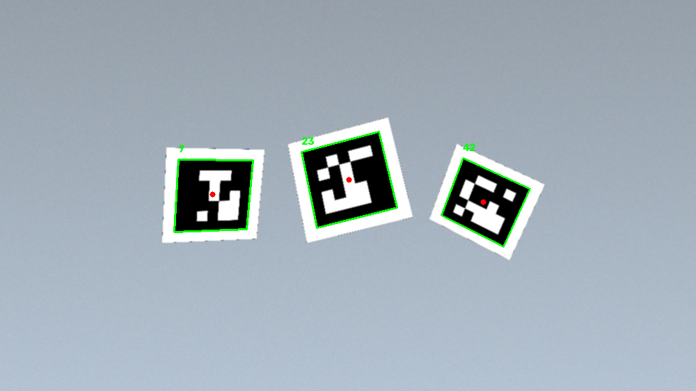
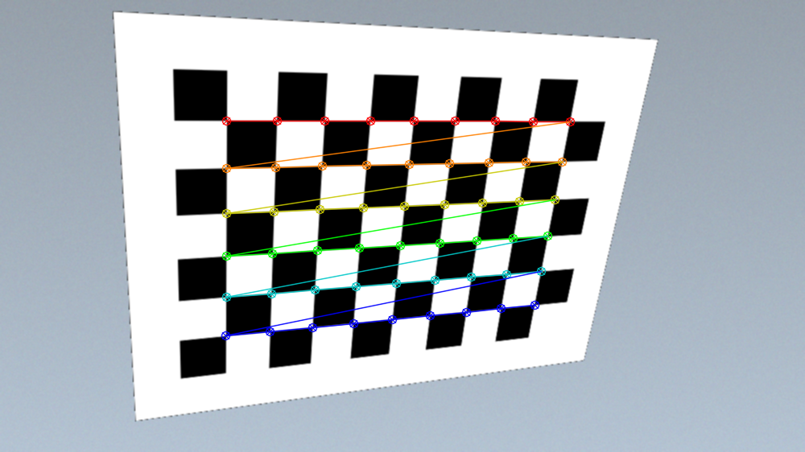
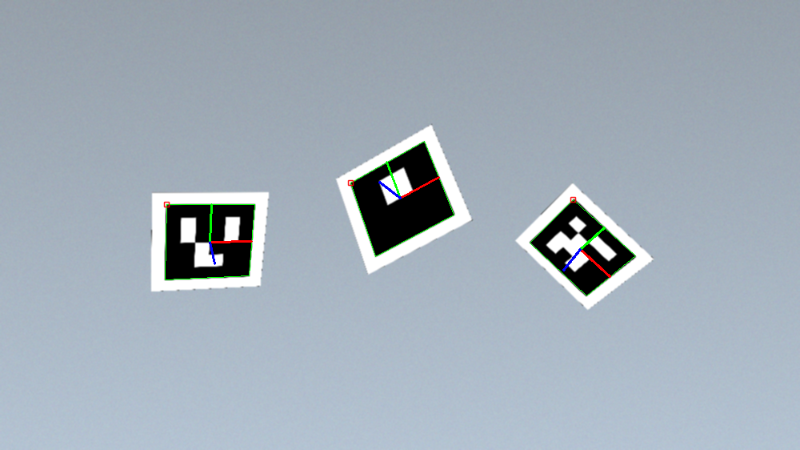

# ArUco Marker Detection and Pose Estimation

Real-time ArUco marker detection from a webcam, chessboard camera calibration, and 6-DoF pose estimation of each
marker (where it is and how it is turned relative to the camera). The usual first steps of vision-based
localisation for drones and robots: a known square marker in view lets a vehicle work out its own position.



**Stack:** Python · OpenCV (`cv2.aruco`, contrib) · NumPy

---

## The three parts

### 1. Marker detection: `aruco marker detection`

Opens the webcam at 1280 × 720, resizes each frame to 1000 px wide and runs `cv2.aruco.detectMarkers` with the
`DICT_5X5_100` dictionary. The script lists all 21 predefined dictionaries (4×4 up to 7×7, the original ArUco set
and the AprilTag families), so switching is a one-line change to `aruco_type`. For every marker found it:

- draws the four edges joining the detected corners (green),
- marks the centre point (red),
- writes the marker ID above the top-left corner and prints it to the console.

Press `q` to quit.

### 2. Camera calibration: `camera calibration`

Pose estimation needs the camera's intrinsics. `calibrate()` takes a folder of photos of a printed chessboard
(9 × 6 inner corners by default), finds the corners in each with `findChessboardCorners`, refines them to sub-pixel
accuracy with `cornerSubPix`, and passes all views to `cv2.calibrateCamera`, which returns the camera matrix **K**
and the distortion coefficients **D**. `save_coefficients()` / `load_coefficients()` write and read them as a YAML
file through `cv2.FileStorage`.



### 3. Pose estimation: `pose estimation`

Loads **K** and **D** from `calibration.yaml`, detects `DICT_4X4_250` markers, and calls
`aruco.estimatePoseSingleMarkers` with a marker side of 2 cm. That gives a rotation vector and a translation vector
per marker (its pose in the camera frame), drawn as a 3D axis on the marker: X red, Y green, Z blue.



> The images in this README are sample outputs on rendered test scenes (markers and a chessboard placed at known
> poses in front of a virtual camera), drawn the same way as the scripts draw them.

---

## Run the detector

The scripts use the pre-4.7 `cv2.aruco` API (`Dictionary_get`, `DetectorParameters_create`, `drawAxis`), so
install an OpenCV contrib build older than 4.7:

```bash
git clone https://github.com/codedchaitanya/aruco-marker-detection-and-pose-estimation.git
cd aruco-marker-detection-and-pose-estimation
pip install "opencv-contrib-python<4.7" numpy
python "aruco marker detection"
```

Print a few markers from the same dictionary (for example from an online ArUco generator, 5×5, 100 markers) and
hold them in front of the camera.

## Background: what the pose means

For a marker of known side length *s*, its four corners in the marker's own frame are fixed 3D points. The detector
gives the same four corners in the image. Solving the Perspective-n-Point problem with the calibrated **K** and **D**
finds the rotation **R** and translation **t** that project the 3D corners onto the 2D ones, so **t** is the marker's
position in metres from the camera and **R** its orientation. Without calibration the scale and the lens
distortion are unknown, which is why step 2 comes first.

---

**Chaitanya Roy** · [GitHub](https://github.com/codedchaitanya) ·
[LinkedIn](https://www.linkedin.com/in/chaitanya-roy-a8b756257/)
